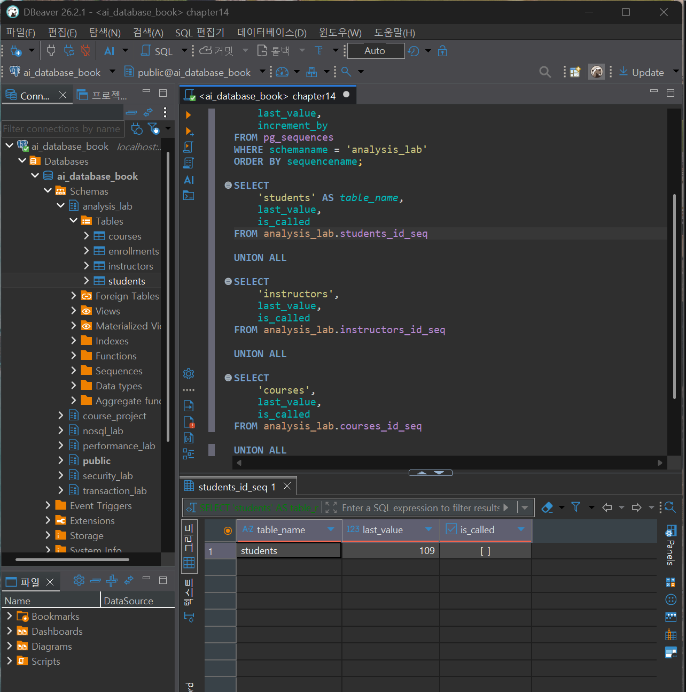
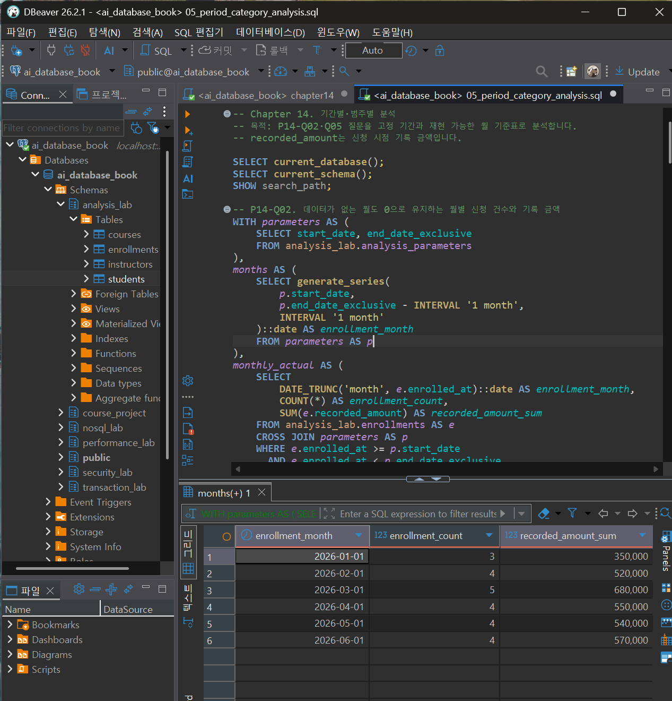
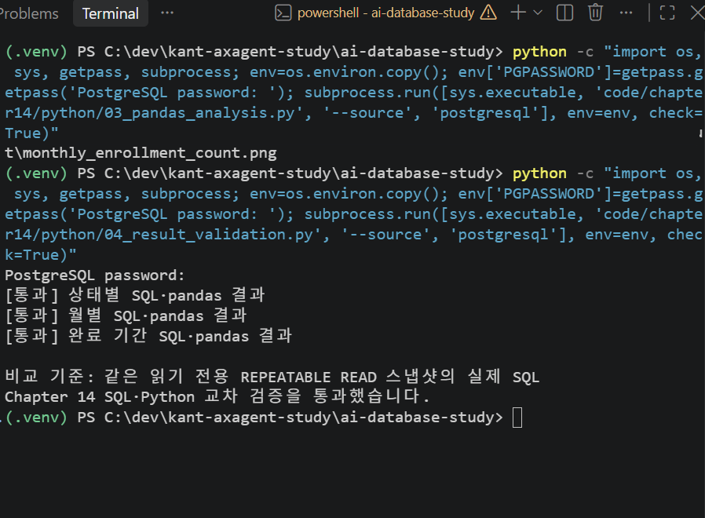
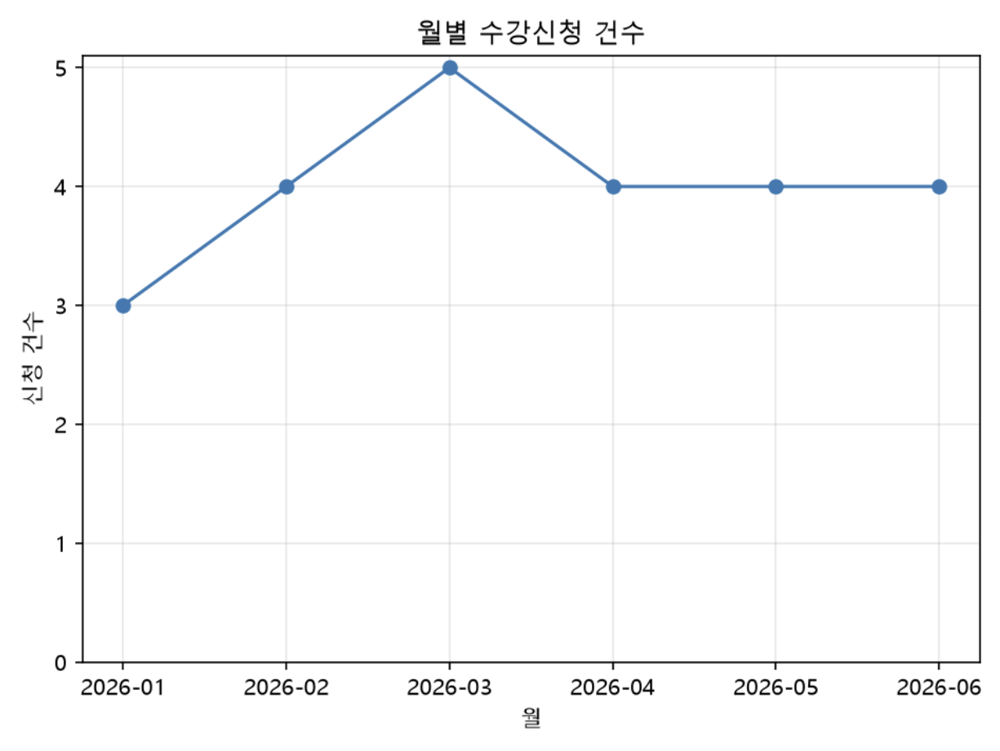

# Chapter 14 확장 실습 답안 템플릿

> **과제:** SQL 데이터 분석과 Python 확장  
> **사용 방법:** 이 파일을 내려받아 본인의 GitHub 저장소에 `chapter14_answer.md`라는 이름으로 저장한 뒤 실습하면서 바로 작성합니다.  
> **제출 방법:** LMS에는 파일을 직접 업로드하지 않고, **본인 GitHub 저장소의 `chapter14_answer.md` 파일 URL**을 제출합니다.

---

## 제출 전 주의

이 파일과 캡처 화면에는 실제 비밀번호, 전체 DB 접속 URL, API Key, password file 내용, 실제 개인정보를 기록하지 않습니다.

```text
GitHub 계정 또는 별칭:sangjae-lee97
과제 작성일:2026.10.21
PostgreSQL 버전:PostgreSQL 18.4 on x86_64-windows, compiled by msvc-19.44.35227, 64-bit
Python 버전: Python 3.14.6
사용한 AI 도구: chatgpt
데이터 읽기 방식: PostgreSQL 직접 연결 / CSV
```

> **핵심 원칙**  
> 그래프가 만들어졌다고 분석이 검증된 것은 아닙니다.  
> **질문 → 기간 → 한 행의 의미 → 지표 정의 → SQL 기준값 → pandas 결과 → 교차 검증**이 모두 일치해야 합니다.

---

# 1. 시작 환경 확인

다음을 실행합니다.

```sql
SELECT version();
SELECT current_database();
SELECT current_user;
SELECT current_schema();
SHOW search_path;
SHOW transaction_read_only;
```

| 확인 항목 | 실제 결과 | 의미 |
| --- | --- | --- |
| PostgreSQL 버전 | PostgreSQL 18.4 (64-bit, Windows) | PostgreSQL 18.4 정상 실행 확인 |
| `current_database()` | `ai_database_book` | 실습 대상 데이터베이스에 정상 연결됨 |
| `current_user` | `postgres` | 현재 접속 계정이 postgres(관리자 계정)임 |
| `current_schema()` | `public` | 현재 기본 스키마가 public임 |
| `search_path` | `public, "$user"` | public 스키마를 먼저 탐색한 후 사용자 이름에 해당하는 스키마를 탐색함 |
| `transaction_read_only` | `off` | 현재 트랜잭션이 읽기 전용으로 설정되어 있지 않음 |


Python도 확인합니다.

```bash
python --version
```

```text
Python 버전: 3.14.6
```

### 분석용 Python 연결을 읽기 전용으로 사용하는 이유

```text
1. **데이터 무결성 보호**: Python 코드의 실수로 원본 데이터가 수정되거나 삭제되는 것을 방지한다.
2. **분석 결과의 신뢰성 확보**: 분석 과정에서 원본 데이터가 변경되어 결과가 왜곡되는 위험을 줄인다.
3. **SQL과 pandas 교차 검증**: 동일한 데이터와 분석 기준으로 계산한 결과를 비교할 수 있도록 한다.
4. **최소 권한 원칙 준수**: 분석 작업에 필요한 조회 권한만 부여하여 데이터베이스의 보안을 강화한다.
```

---

# 2. 분석 질문 계약 작성

Chapter 14의 기준 질문은 다음과 같습니다.

```text
P14-Q01 상태별 수강신청 건수
P14-Q02 월별 신청 건수와 신청 시점 기록 금액
P14-Q03 강의별 신청 건수
P14-Q04 지역별 학생 수와 신청 건수
P14-Q05 완료된 신청의 완료 기간
```

그중 최소 2개를 골라 SQL보다 먼저 분석 계약을 작성합니다.

## 질문 A

```text
질문 ID: P14-Q01
업무 질문: 2026년 1월부터 6월까지 수강신청 상태별 신청 건수는 각각 몇 건인가?
분석 기간: [2026-01-01, 2026-07-01)
날짜 기준: enrolled_at (수강신청일)
한 행의 의미: 원본 데이터 1행은 수강신청 1건(enrollment_id)이며, 집계 결과 1행은 하나의 신청 상태를 의미한다.
포함 상태: 신청, 수강중, 완료, 취소
제외 상태: 없음. 단, 분석 기간 밖의 데이터는 제외한다.
지표 이름: 상태별 수강신청 건수
지표의 업무 의미: 분석 기간 동안 접수된 수강신청을 현재 기록된 상태별로 분류하여 신청 현황을 파악한다.
예상 검산 방법: SQL에서 GROUP BY status로 집계한 결과를 전체 신청 건수와 비교한다. 기준값은 신청 4건, 수강중 5건, 완료 12건, 취소 3건이며 총합은 24건이다. 이후 pandas의 groupby() 결과와 비교한다.
```

## 질문 B

```text
질문 ID: P14-Q02
업무 질문: 2026년 1월부터 6월까지 월별 수강신청 건수와 신청 시점 기록 금액의 합계는 얼마인가?
분석 기간: [2026-01-01, 2026-07-01)
날짜 기준: enrolled_at (수강신청일)
한 행의 의미: 원본 데이터 1행은 수강신청 1건이며, 집계 결과 1행은 하나의 신청 월을 의미한다.
포함 상태: 신청, 수강중, 완료, 취소
제외 상태: 없음. 단, 분석 기간 밖의 데이터는 제외한다.
지표 이름: 월별 수강신청 건수, 월별 recorded_amount 합계
지표의 업무 의미: 월별 신청 규모와 신청 당시 기록된 금액의 변화를 파악한다. 기록 금액은 실제 결제 매출을 의미하지 않는다.
예상 검산 방법: SQL에서 신청 월을 기준으로 COUNT(*)와 SUM(recorded_amount)를 계산한다. 월별 건수 합계는 24건, 기록 금액 합계는 3,210,000이어야 한다. 이후 pandas의 groupby()로 동일하게 집계하여 비교한다. 데이터가 없는 월도 확인할 수 있도록 date spine을 사용한다.
```

Chapter 14 기준 분석 기간:

```text
[2026-01-01, 2026-07-01)
```

### 반개방 구간 `[start, end)`을 사용하는 이유

```text
반개방 구간은 시작일을 포함하고 종료일은 포함하지 않는 방식이다.

Chapter 14의 분석 기간은 [2026-01-01, 2026-07-01)로, 2026년 1월 1일부터 6월 30일까지의 데이터를 포함하고 7월 1일부터는 제외한다.

이 방식을 사용하는 이유는 다음과 같다.

날짜뿐 아니라 시각이 포함된 데이터도 정확하게 구분할 수 있다.

종료일의 마지막 시각을 별도로 계산할 필요가 없다.

연속된 분석 기간 사이에서 데이터가 중복 집계되는 문제를 방지한다.
```

### `recorded_amount`의 정확한 업무 의미

```text
recorded_amount는 수강신청이 발생한 시점에 해당 신청 내역에 기록된 금액을 의미한다.

신청 당시의 금액을 보존하는 역사적 데이터이며, 이후 수강신청 상태가 취소로 변경되더라도 기존 금액을 임의로 0으로 변경하지 않는다.

따라서 이 값은 신청 시점의 금액 규모를 분석하는 데 사용하며, 실제 결제 여부나 환불 여부를 직접 나타내지는 않는다.
```

### 왜 `recorded_amount`를 실제 결제 매출 또는 회계 매출이라고 부르면 안 되나요?

```text
recorded_amount는 신청 당시 기록된 금액이지 실제 결제가 완료된 금액이 아니기 때문이다.

예를 들어 학생이 100,000원짜리 강의를 신청한 뒤 취소하더라도 recorded_amount에는 100,000원이 남아 있을 수 있다.

따라서 이 금액에는 다음 정보가 반영되어 있다고 보장할 수 없다.

1. 실제 결제 승인 여부

2. 결제 취소 및 환불 내역

3. 할인 및 정산 결과

4. 회계상 매출 인식 여부

즉, recorded_amount의 합계인 3,210,000은 신청 시점 기록 금액의 합계이지 실제 결제 매출이나 회계 매출이 아니다.
```

---

# 3. `analysis_lab` 생성과 Seed 기준 확인

다음 파일을 순서대로 실행합니다.

```text
code/chapter14/01_analysis_lab_schema.sql
code/chapter14/02_analysis_lab_seed.sql
```

기준 상태:

| 객체 | 기대값 | 실제값 | 일치? |
| --- | ---: | ---: | --- |
| `students` | 8 | 8 | 일치 |
| `instructors` | 3 | 3 | 일치 |
| `courses` | 5 | 5 | 일치 |
| `enrollments` | 24 | 24 | 일치 |

IDENTITY 다음 값도 확인한 경우 기록합니다.

```text
students 다음 값: 109
instructors 다음 값: 204
courses 다음 값: 306
enrollments 다음 값: 1025
```

본문 기준:

```text
students = 109 이상
instructors = 204 이상
courses = 306 이상
enrollments = 1025 이상
```

### `analysis_lab`을 기존 `course_project`와 분리한 이유

```text
analysis_lab`은 Chapter 14의 SQL 및 Python 데이터 분석 실습을 위한 독립적인 스키마이다.

기존 `course_project`와 분리한 이유는 다음과 같다.

1. **기존 데이터 보호**: 분석 실습 과정에서 기존 `course_project`의 데이터가 변경되거나 삭제되는 것을 방지한다.
2. **실습 환경 독립성 확보**: 분석 전용 합성 데이터를 사용하여 기존 프로젝트에 영향을 주지 않고 실습할 수 있다.
3. **분석 결과의 재현성 확보**: 동일한 Seed 데이터와 기준값을 사용하여 SQL과 pandas 분석 결과를 반복적으로 검증할 수 있다.
4. **오류 원인 파악 용이**: 분석 결과에 문제가 발생했을 때 기존 프로젝트와 구분하여 원인을 확인할 수 있다.

**결론:** `analysis_lab`을 분리한 이유는 기존 데이터를 보호하면서 독립적이고 재현 가능한 분석 환경을 구축하기 위해서이다.
```

### 증거 화면

권장 경로:

```text
assignments/chapter14/images/step03_seed_baseline.png
```

`여기에 기준 행 수 또는 Seed 검증 화면을 삽입하세요.`

---

# 4. 집계 전에 데이터 품질 검사

다음을 실행합니다.

```text
code/chapter14/03_data_quality_checks.sql
```

정상 기준에서는 다음 이상 건수가 모두 0이어야 합니다.

| 품질 검사 | 예상 | 실제 | 통과? |
| --- | ---: | ---: | --- |
| PK 또는 분석 VIEW 중복 | 0 | 0 | PASS |
| 고아 학생 FK | 0 | 0 | PASS |
| 고아 강의 FK | 0 | 0 | PASS |
| 고아 강사 FK | 0 | 0 | PASS |
| 완료인데 `completed_at` 없음 | 0 | 0 | PASS |
| 미완료인데 `completed_at` 존재 | 0 | 0 | PASS |
| 완료일 < 신청일 | 0 | 0 | PASS |
| 신청일 < 학생 가입일 | 0 | 0 | PASS |
| 신청일 < 강의 개설일 | 0 | 0 | PASS |
| 음수 `recorded_amount` | 0 | 0 | PASS |
| 취소 후 기록 금액이 0으로 덮인 행 | 0 | 0 | PASS |
| 분석 기간 밖 기준 데이터 | 0 | 0 | PASS |
| 활성 신청 중복 | 0 | 0 | PASS |

### 품질 검사를 집계보다 먼저 해야 하는 이유

```text
원본 데이터에 오류가 있으면 SQL 집계문이 정확하더라도 잘못된 분석 결과가 생성될 수 있기 때문이다.

예를 들어 수강신청 데이터가 중복되어 있다면 `COUNT(*)`로 계산한 신청 건수가 실제보다 많아질 수 있다.

따라서 집계 전에 중복, NULL, 참조 무결성, 날짜 및 금액 오류 등을 확인해야 한다.
```

### SQL이 정상 실행돼도 원본 품질이 잘못되면 분석 결과를 신뢰할 수 없는 이유

```text
SQL의 정상 실행은 문법과 실행 과정에 문제가 없다는 뜻이지, 데이터 자체가 정확하다는 의미는 아니다.

예를 들어 실제 신청이 24건인데 중복 데이터가 1건 존재한다면 SQL은 오류 없이 25건으로 집계할 수 있다.

즉, SQL은 잘못된 데이터도 정확한 계산 방식으로 처리할 수 있다.

따라서 분석 결과를 신뢰하려면 SQL 실행 성공뿐 아니라 원본 데이터의 정확성, 무결성, 중복 여부를 함께 검증해야 한다.

```

---

# 5. SQL 기준 결과 만들기

다음을 실행합니다.

```text
code/chapter14/04_summary_analysis.sql
code/chapter14/05_period_category_analysis.sql
```

## 5-1. 전체 기준

```text
전체 신청 행 수 기대 = 24
전체 recorded_amount 기대 = 3210000
```

```text
실제 신청 행 수: 24
실제 recorded_amount 합계: 3210000
일치 여부: PASS
```

## 5-2. 상태별 기준

| 상태 | 기대 건수 | 실제 건수 | 일치? |
| --- | ---: | ---: | --- |
| 신청 | 4 | 4 | PASS |
| 수강중 | 5 | 5 | PASS |
| 완료 | 12 | 12 | PASS |
| 취소 | 3 | 3 | PASS |
| **합계** | **24** | **24** | **PASS** |

### 상태별 그룹 합을 전체 24건과 다시 비교해야 하는 이유

상태별로 집계한 결과가 전체 수강신청 건수와 일치하는지 확인하기 위해서이다.

예를 들어 특정 상태가 누락되거나 집계 조건이 잘못 적용되면 상태별 건수의 합계가 전체 건수와 달라질 수 있다.

따라서 `GROUP BY`로 계산한 각 상태의 건수를 합산하고 전체 신청 건수인 24건과 비교해야 한다.

다만 합계가 일치하더라도 원본 데이터의 중복이나 오류가 없다는 사실까지 보장되지는 않으므로 별도의 데이터 품질 검증도 필요하다.

**결론:** 전체 건수와 그룹별 합계를 비교하면 집계의 일관성을 확인하고 누락이나 집계 오류를 발견하는 데 도움이 된다.

## 5-3. 월별 기준

| 월 | 기대 신청 건수 | 실제 신청 건수 | 기대 기록 금액 | 실제 기록 금액 | 일치? |
| --- | ---: | ---: | ---: | ---: | --- |
| 2026-01 | 3 | 3 | 350000 | 350000 | PASS |
| 2026-02 | 4 | 4 | 520000 | 520000 | PASS |
| 2026-03 | 5 | 5 | 680000 | 680000 | PASS |
| 2026-04 | 4 | 4 | 550000 | 550000 | PASS |
| 2026-05 | 4 | 4 | 540000 | 540000 | PASS |
| 2026-06 | 4 | 4 | 570000 | 570000 | PASS |
| **합계** | **24** | **24** | **3210000** | **3210000** | **PASS** |

**검증 결과:** 월별 신청 건수와 `recorded_amount` 합계가 모두 기대값과 일치하였다.

## 5-4. 완료 기간 기준

```text
완료 건수 기대 = 12
평균 완료 기간 기대 = 25일
최소 완료 기간 기대 = 18일
최대 완료 기간 기대 = 36일
```

```text
실제 완료 건수: 12건
실제 평균 완료 기간: 25.00일
실제 최소 완료 기간: 18일
실제 최대 완료 기간: 36일

일치 여부: PASS
```

### 완료 12건의 평균 25일을 전체 수강생의 평균 완료 기간이라고 일반화하면 안 되는 이유

```text
평균 완료 기간 25일은 전체 수강신청 24건 중 완료 상태인 12건만을 대상으로 계산한 결과이기 때문이다.

수강중, 신청, 취소 상태인 나머지 12건은 최종 완료 기간을 알 수 없거나 완료되지 않은 데이터이므로 계산에서 제외되었다.

또한 한 학생이 여러 강의를 신청할 수 있으므로 완료된 신청 12건이 서로 다른 학생 12명을 의미하는 것도 아니다.

따라서 평균 25일이라는 결과는 완료된 수강신청 12건에 대해서만 유효하며 전체 수강생의 평균 완료 기간으로 일반화할 수 없다.
```

### 증거 화면

권장 경로:

```text
assignments/chapter14/images/step05_sql_metrics.png
```

`여기에 SQL 기준 결과가 보이는 핵심 화면을 삽입하세요.`

---

# 6. date spine과 데이터 없는 월

월별 분석에서 `generate_series` 기반 date spine을 사용하는 이유를 설명합니다.

```text
실제 데이터만 GROUP BY했을 때:
실제 수강신청 데이터가 존재하는 월만 집계 결과에 나타난다.

예를 들어 3월에 신청 건수가 0건이라면 GROUP BY 결과에서 3월 자체가 누락된다.

따라서 데이터가 없는 월과 분석 대상에서 제외된 월을 구분하기 어렵다.

date spine을 먼저 만들고 LEFT JOIN했을 때:
generate_series를 사용하여 분석 기간인 2026년 1월부터 6월까지의 모든 월을 먼저 생성한다.

이후 실제 월별 신청 데이터를 LEFT JOIN하면 신청 데이터가 없는 월도 결과에 유지된다.

신청 건수나 기록 금액이 NULL인 경우 COALESCE를 사용하여 0으로 표시할 수 있다.

따라서 데이터가 없는 월까지 포함한 연속적인 월별 분석이 가능하다.
```

### 데이터가 0건인 월을 결과에 남겨야 하는 이유

```text
데이터가 없는 월도 분석 기간에 포함된 중요한 관측 대상이기 때문이다.

0건인 월을 제외하면 특정 기간에 신청이 발생하지 않았다는 사실을 확인하기 어렵고, 월별 추세가 왜곡될 수 있다.

또한 연속된 월별 데이터가 있어야 전월 대비 증감률이나 시계열 분석을 정확하게 수행할 수 있다.
```

### 중간 월이 빠진 상태에서 `LAG`를 쓰면 어떤 해석 오류가 생길 수 있나요?

```text
LAG는 정렬된 데이터에서 바로 이전 행의 값을 가져오는 함수이다.

3월이 누락된 상태에서 LAG를 사용하면 4월의 이전 행은 2월이 된다.

따라서 4월의 신청 건수 5건을 2월의 4건과 비교하여 전월 대비 1건 증가했다고 잘못 해석할 수 있다.

하지만 실제 직전 달인 3월은 0건이므로 4월은 전월 대비 5건 증가한 것이다.

date spine을 사용하면 3월도 0건으로 유지되므로 LAG가 올바른 직전 달의 값을 참조할 수 있다.
```

---

# 7. 분석 VIEW 검증

다음을 실행합니다.

```text
code/chapter14/06_analysis_dataset.sql
code/chapter14/07_analysis_validation.sql
```

대상 VIEW:

```text
analysis_lab.enrollment_analysis_dataset
```

한 행의 의미:

```text
수강신청 1건 = enrollment_id 1개
```

## 7. 분석 VIEW 검증

### 기준

```text
정확한 컬럼 수 = 17
VIEW 행 수 = 24
고유 enrollment_id = 24
중복 enrollment_id = 0
recorded_amount 합계 = 3210000
완료 행 = 12
분석 기간 밖 행 = 0
```

### 실제 결과

```text
컬럼 수: 17개 (VIEW 생성 SQL 기준)
VIEW 행 수: 24
고유 enrollment_id: 24
중복 enrollment_id: 0
recorded_amount 합계: 3210000
완료 행: 12
분석 기간 밖 행: 0

검증 결과: PASS
```

### VIEW의 행 단위가 깨진 상태로 Python 분석을 진행하면 어떤 문제가 생기나요?

분석 VIEW의 한 행은 수강신청 1건을 의미한다.

만약 잘못된 JOIN으로 하나의 수강신청이 여러 행으로 중복된다면 Python에서도 중복된 데이터를 분석하게 된다.

이로 인해 다음과 같은 문제가 발생할 수 있다.

1. **신청 건수 과대 집계:** 실제보다 수강신청 건수가 많게 계산된다.
2. **기록 금액 왜곡:** 중복된 행의 `recorded_amount`가 반복 합산되어 금액이 부풀려진다.
3. **통계 결과 왜곡:** 중복된 신청이 평균이나 비율 계산에 더 큰 영향을 줄 수 있다.
4. **SQL과 pandas 검증 오류:** 서로 다른 행 단위로 집계하면 결과가 일치하지 않을 수 있으며, 동일한 중복 데이터로 계산하면 두 결과가 일치하더라도 모두 잘못될 수 있다.

예를 들어 실제 신청은 24건인데 JOIN 오류로 1건이 중복되면 Python에서는 25건으로 계산될 수 있다.

따라서 Python 분석 전에 VIEW의 전체 행 수, 고유 ID 수, 중복 여부를 검증해야 한다.


---

# 8. SQL 최종 완료 게이트

다음을 실행합니다.

```text
code/chapter14/08_analysis_lab_validation.sql
```

기대 메시지:

```text
Chapter 14 analysis_lab validation passed: rows 8/3/5/24/24, amount 3210000
```

실제 메시지:

```text

```

### 이 게이트가 실패했을 때 기대값을 현재 데이터에 맞게 수정하면 안 되는 이유

```text

```

---

# 8. SQL 최종 완료 게이트

실행 파일:

`code/chapter14/08_analysis_lab_validation.sql`

### 기대 메시지

```text
Chapter 14 analysis_lab validation passed: rows 8/3/5/24/24, amount 3210000
```

### 실제 메시지

```text
Chapter 14 analysis_lab validation passed: rows 8/3/5/24/24, amount 3210000
```

**검증 결과: PASS (최종 검증 통과)**

### 검증 과정 및 오류 해결

초기 검증에서는 PostgreSQL 18.4의 `NOT NULL` 제약조건 집계 방식 차이로 인해 제약조건이 기대값인 20개가 아닌 40개로 계산되는 문제가 발생했다.

실제 제약조건을 확인한 결과는 다음과 같다.

| 제약조건 유형 | 실제 개수 |
| --- | ---: |
| CHECK | 12 |
| FOREIGN KEY | 3 |
| NOT NULL | 20 |
| PRIMARY KEY | 4 |
| UNIQUE | 1 |
| **전체** | **40** |
| **NOT NULL 제외** | **20** |

PostgreSQL 18에서는 `NOT NULL` 제약조건도 `pg_constraint`에 포함되므로 기존 검증 SQL과 호환성 문제가 발생한 것이다.

이를 해결하기 위해 원본 검증 SQL의 제약조건 집계 조건을 다음과 같이 수정하였다.

```sql
WHERE connamespace = 'analysis_lab'::regnamespace
  AND contype IN ('p', 'f', 'u', 'c');
```

이후 RESET 실행으로 분석 환경의 핵심 테이블 또는 VIEW가 존재하지 않는 오류도 발생했으나, 최종적으로 필요한 객체를 갖춘 상태에서 수정된 검증 SQL을 재실행하여 정상 통과하였다.

**최종 검증 결과:**

- 학생: 8명
- 강사: 3명
- 강의: 5개
- 수강신청: 24건
- 분석 VIEW: 24행
- `recorded_amount` 합계: 3,210,000
- 최종 자동 검증: PASS

### 이 게이트가 실패했을 때 기대값을 현재 데이터에 맞게 수정하면 안 되는 이유

최종 검증 게이트는 데이터베이스의 실제 구조와 데이터가 사전에 정의한 기준을 만족하는지 확인하는 과정이다.

검증에 실패했다고 기대값을 현재 결과에 맞춰 변경하면 실제 오류를 발견하지 못하고 잘못된 상태를 정상으로 판단할 수 있다.

예를 들어 수강신청의 기대 건수가 24건인데 실제로 23건만 존재한다면, 기대값을 23건으로 변경하는 것이 아니라 누락된 데이터가 있는지 확인해야 한다.

다만 PostgreSQL 버전 차이처럼 검증 SQL 자체의 호환성 문제가 확인된 경우에는 원래 검증 목적을 유지하면서 검사 방식을 수정할 수 있다.

이번 실습에서도 제약조건의 기대값 20개를 40개로 변경하지 않고, PostgreSQL 18.4에서 추가로 집계되는 `NOT NULL` 제약조건을 제외하여 기존 검증 기준을 유지하였다.

---

# 10. 데이터 읽기 방식 선택

아래 둘 중 하나를 선택합니다.

```text
A. 읽기 전용 PostgreSQL 직접 연결
B. CSV + manifest + SQL reference metrics
```

내 선택: A. 읽기 전용 PostgreSQL 직접 연결

```text
선택 방식: A. 읽기 전용 PostgreSQL 직접 연결
선택 이유:
1. PostgreSQL의 분석 VIEW에서 데이터를 직접 조회하므로 별도의 CSV 파일을 관리할 필요가 없다.
2. SQL과 pandas가 동일한 데이터베이스의 데이터를 사용하므로 데이터 출처를 명확하게 확인할 수 있다.
3. REPEATABLE READ 읽기 전용 트랜잭션을 사용하면 동일한 데이터 스냅샷에서 SQL과 pandas 결과를 교차 검증할 수 있다.
4. 읽기 전용 연결을 사용하여 Python 분석 과정에서 원본 데이터가 실수로 변경되는 위험을 줄일 수 있다.
5. CSV 파일의 최신 여부나 manifest 관리에서 발생할 수 있는 불일치 위험을 줄일 수 있다.
```

## A를 선택한 경우

권장 명령:

```bash
python code/chapter14/python/02_load_postgresql.py --export-csv code/chapter14/data/enrollment_analysis_dataset.csv
python code/chapter14/python/03_pandas_analysis.py --source postgresql
python code/chapter14/python/04_result_validation.py --source postgresql
```

확인 사항:

```text
현재 DB: ai_database_book
transaction_read_only: on
읽은 VIEW: analysis_lab.enrollment_analysis_dataset
행 수: 24
```

### 같은 `REPEATABLE READ` 읽기 전용 스냅샷에서 SQL과 pandas를 비교하는 장점

```text
`REPEATABLE READ`는 하나의 트랜잭션에서 동일한 데이터 스냅샷을 유지하는 격리 수준이다.

SQL과 pandas가 같은 스냅샷을 사용하면 분석 도중 다른 사용자가 데이터를 변경하더라도 두 분석은 동일한 시점의 데이터를 기준으로 수행된다.

주요 장점은 다음과 같다.

1. **데이터 일관성 확보:** SQL과 pandas가 동일한 데이터를 사용하므로 분석 시점 차이로 인한 불일치를 방지한다.
2. **정확한 교차 검증:** 두 결과가 다르다면 데이터 변경보다는 집계 방식, 자료형 변환, NULL 처리 등의 차이를 중심으로 원인을 분석할 수 있다.
3. **원본 데이터 보호:** 읽기 전용 트랜잭션으로 데이터 변경을 방지한다.
4. **분석 신뢰성 향상:** 동일한 조건에서 두 분석 결과를 비교하여 계산의 정확성을 검증할 수 있다.
```

## B를 선택한 경우

권장 명령:

```bash
python code/chapter14/python/01_load_csv.py --require-manifest
python code/chapter14/python/03_pandas_analysis.py
python code/chapter14/python/04_result_validation.py --source csv
```

확인 사항:

```text
CSV 파일:
manifest 파일:
원본 DB:
원본 VIEW:
분석 기간:
CSV 행 수:
SHA-256 확인 여부:
```

### CSV만 있고 출처·기간·해시 정보가 없다면 재현성이 약해지는 이유

```text

```

---

# 11. DataFrame 구조와 엄격한 자료형 검증

### DataFrame 구조 및 자료형

```text
shape: (24, 17)
컬럼 수: 17개

날짜 컬럼 dtype:
- enrolled_at: datetime64[ns]
- enrollment_month: datetime64[ns]
- completed_at: datetime64[ns]

recorded_amount dtype: int64
completion_days dtype: float64
is_completed dtype: bool
```

### 공통 검증 결과

| 검증 항목 | 실제 결과 | 판정 |
| --- | --- | --- |
| 정확한 17개 컬럼 | 17개 | PASS |
| 전체 행 수 | 24행 | PASS |
| enrollment_id 고유성 | 중복 없음 | PASS |
| 날짜 strict 변환 | 성공 | PASS |
| recorded_amount strict 숫자 변환 | 성공 | PASS |
| completion_days strict 숫자 변환 | 성공 | PASS |
| is_completed boolean | bool | PASS |
| status와 is_completed 일치 | 일치 | PASS |
| 완료 상태와 완료일·완료 기간 일치 | 일치 | PASS |
| 분석 기간 [2026-01-01, 2026-07-01) | 충족 | PASS |

**검증 결과: PASS**

PostgreSQL 읽기 전용 연결을 통해 분석 VIEW를 불러왔으며, 교수자의 `validate_dataframe()`을 사용한 엄격한 검증을 정상 통과하였다.

### `errors='coerce'`, 무조건적인 `dropna()`, `drop_duplicates()`가 위험할 수 있는 이유

세 기능은 데이터 처리에 유용하지만 잘못 사용하면 원본 데이터의 오류를 숨길 수 있기 때문이다.

1. **`errors='coerce'`**: 변환할 수 없는 값을 NaN이나 NaT로 바꾸므로 데이터 변환 오류를 발견하지 못할 수 있다.
2. **`dropna()`**: 결측값이 포함된 행을 삭제하므로 완료일이 없는 정상적인 미완료 신청까지 제거할 수 있다.
3. **`drop_duplicates()`**: 중복 행을 제거하지만 잘못된 JOIN이나 데이터 입력으로 발생한 중복의 근본적인 원인을 해결하지 못한다.

이번 실습에서는 `errors='raise'`를 사용하여 변환 오류를 명확하게 확인하고, 중복이나 결측값을 임의로 제거하지 않는다.

**결론:** 데이터를 임의로 정리하여 결과를 맞추는 것보다 오류의 원인을 파악하고 올바르게 처리하는 것이 중요하다.

### 오류 행을 조용히 삭제하지 않고 원인을 먼저 확인해야 하는 이유

오류 행을 확인하지 않고 삭제하면 분석 대상 데이터의 수와 구성이 달라져 통계 결과가 왜곡될 수 있기 때문이다.

예를 들어 수강신청 24건 중 1건에서 금액 변환 오류가 발생했다고 가정하자.

해당 행을 무조건 삭제하면 실제로는 24건이지만 pandas에서는 23건만 분석하게 되어 SQL 기준값과 불일치할 수 있다.

또한 오류의 원인이 잘못된 자료형인지, 데이터 입력 오류인지, JOIN 중복인지 확인할 수 없게 된다.

따라서 오류가 발생하면 원본 데이터, 자료형 변환 과정, 중복 여부를 순서대로 점검해야 한다.

**결론:** 오류를 숨기거나 행을 임의로 삭제하지 않아야 SQL과 pandas 분석 결과의 신뢰성을 확보할 수 있다.

**STEP 11 최종 검증: PASS**


---

# 12. pandas 분석 결과

다음을 실행합니다.

```text
code/chapter14/python/03_pandas_analysis.py
```

PostgreSQL 직접 경로라면 `--source postgresql`을 사용합니다.

# 12. pandas 분석 결과

## 12-1. pandas 상태별 건수

| 상태 | SQL 기준 | pandas | 일치? |
| --- | ---: | ---: | --- |
| 신청 | 4 | 4 | PASS |
| 수강중 | 5 | 5 | PASS |
| 완료 | 12 | 12 | PASS |
| 취소 | 3 | 3 | PASS |
| **합계** | **24** | **24** | **PASS** |

**검증 결과:** SQL과 pandas의 상태별 신청 건수가 모두 일치하였다.

## 12-2. pandas 월별 건수·금액

| 월 | SQL 건수 | pandas 건수 | SQL 금액 | pandas 금액 | 일치? |
| --- | ---: | ---: | ---: | ---: | --- |
| 2026-01 | 3 | 3 | 350000 | 350000 | PASS |
| 2026-02 | 4 | 4 | 520000 | 520000 | PASS |
| 2026-03 | 5 | 5 | 680000 | 680000 | PASS |
| 2026-04 | 4 | 4 | 550000 | 550000 | PASS |
| 2026-05 | 4 | 4 | 540000 | 540000 | PASS |
| 2026-06 | 4 | 4 | 570000 | 570000 | PASS |
| **합계** | **24** | **24** | **3210000** | **3210000** | **PASS** |

**검증 결과:** 월별 신청 건수와 신청 시점 기록 금액이 모두 SQL 기준값과 일치하였다.

## 12-3. pandas 완료 기간

```text
완료 건수: 12건
평균 완료 기간: 25.00일
최소 완료 기간: 18일
최대 완료 기간: 36일

SQL 기준값과 일치 여부: PASS
```

완료 상태인 12건만을 대상으로 계산하였으며, 전체 수강생의 평균 완료 기간을 의미하지 않는다.

## 12-4. 피벗 또는 범주 분석

```text
선택한 피벗/범주: 강의별 수강신청 상태 분석
행 기준: course_title (강의명)
열 기준: status (신청, 수강중, 완료, 취소)
값: enrollment_id의 건수 (COUNT)
전체 합계가 원본과 일치하는가: YES (24건)
```

### 실제 피벗 분석 결과

| 강의명 | 신청 | 수강중 | 완료 | 취소 | 합계 |
| --- | ---: | ---: | ---: | ---: | ---: |
| AI 활용 데이터 설계 | 1 | 2 | 1 | 0 | 4 |
| SQL 데이터 분석 | 1 | 1 | 2 | 0 | 4 |
| 데이터 시각화 | 2 | 0 | 2 | 1 | 5 |
| 데이터베이스 입문 | 0 | 1 | 5 | 0 | 6 |
| 파이썬 데이터 분석 | 0 | 1 | 2 | 2 | 5 |
| **합계** | **4** | **5** | **12** | **3** | **24** |

**검증 결과:** 피벗 테이블의 전체 신청 건수 24건이 원본 데이터 및 SQL 집계 결과와 일치하였다.

---

# 13. SQL ↔ pandas 최종 교차 검증

실행 파일:

`code/chapter14/python/04_result_validation.py`

실행 방식:

```powershell
python code/chapter14/python/04_result_validation.py --source postgresql
```

실제 실행에서는 PostgreSQL 비밀번호를 환경 변수로 전달하여 읽기 전용 연결을 사용하였다.

## 핵심 비교표

| 지표 | SQL | pandas | 일치? |
| --- | ---: | ---: | --- |
| 전체 행 수 | 24 | 24 | PASS |
| 고유 enrollment_id | 24 | 24 | PASS |
| `recorded_amount` 합계 | 3210000 | 3210000 | PASS |
| 신청 | 4 | 4 | PASS |
| 수강중 | 5 | 5 | PASS |
| 완료 | 12 | 12 | PASS |
| 취소 | 3 | 3 | PASS |
| 완료 건수 | 12 | 12 | PASS |
| 평균 완료 기간 | 25 | 25 | PASS |
| 최소 완료 기간 | 18 | 18 | PASS |
| 최대 완료 기간 | 36 | 36 | PASS |

## 최종 Python 검증 결과

```text
[통과] 상태별 SQL·pandas 결과
[통과] 월별 SQL·pandas 결과
[통과] 완료 기간 SQL·pandas 결과

비교 기준: 같은 읽기 전용 REPEATABLE READ 스냅샷의 실제 SQL
Chapter 14 SQL·Python 교차 검증을 통과했습니다.

최종 검증 결과: PASS
```

SQL과 pandas를 동일한 읽기 전용 `REPEATABLE READ` 스냅샷에서 비교한 결과, 상태별 신청 건수, 월별 신청 건수 및 금액, 완료 기간 통계가 모두 일치하였다.

전체 행 수, 고유 ID 및 기록 금액 합계도 앞선 데이터 검증에서 기준값과 일치함을 확인하였다.

따라서 SQL과 pandas가 동일한 분석 기준에 따라 일관된 결과를 생성함을 확인하였다.

## SQL과 pandas 결과가 다를 때 확인할 순서를 자신의 말로 작성

```text
1. SQL과 pandas가 동일한 PostgreSQL 데이터베이스와 분석 VIEW를 사용했는지 확인한다.

2. 분석 기간과 날짜 기준이 동일한지 확인한다. 특히 시작일 포함, 종료일 제외 조건이 같은지 검사한다.

3. 동일한 데이터 스냅샷에서 분석했는지 확인한다. 분석 중 원본 데이터가 변경되면 결과가 달라질 수 있다.

4. 한 행이 수강신청 1건이라는 기준을 유지하는지 확인한다. JOIN으로 인한 중복이나 데이터 누락 여부를 검사한다.

5. 상태별 포함·제외 조건과 NULL 처리, 자료형 변환 방식이 SQL과 pandas에서 동일한지 확인한다.

6. COUNT, SUM, AVG 등의 집계 방식과 계산 결과를 단계별로 비교하여 차이가 발생한 지점을 찾고 원인을 수정한다.
```

**결론:** SQL과 pandas 분석 결과가 다를 경우 기대값을 변경하거나 데이터를 임의로 삭제하지 않고, 데이터 출처부터 집계 방식까지 순서대로 검증하여 불일치 원인을 해결해야 한다.

**Chapter 14 SQL ↔ pandas 최종 교차 검증: PASS**

### 증거 화면

권장 경로:

```text
assignments/chapter14/images/step13_cross_validation.png
```

`여기에 SQL↔pandas 검증 성공 또는 핵심 비교 화면을 삽입하세요.`

---

# 14. 시각화 검증

### 생성한 그래프

```text
그래프 제목: 월별 수강신청 건수
X축 의미: 2026년 1월부터 6월까지의 수강신청 월
Y축 의미: 해당 월의 수강신청 건수 (단위: 건)
사용한 데이터: analysis_lab.enrollment_analysis_dataset VIEW에서 조회한 24건의 수강신청 데이터를 pandas로 월별 집계한 결과
```

### 그래프 검토 결과

```text
월 순서가 올바른가: YES (2026-01 ~ 2026-06 순서)

Y축이 0부터 시작하는가: YES

표와 그래프의 값이 같은가: YES (3, 4, 5, 4, 4, 4)

누락된 월이 없는가: YES (1월부터 6월까지 모두 표시)

단위를 오해할 표현이 없는가: YES (Y축에 '신청 건수', X축에 '월'을 명시)
```

### 월별 데이터 검증

| 월 | SQL 신청 건수 | pandas 신청 건수 | 그래프 표시값 | 판정 |
| --- | ---: | ---: | ---: | --- |
| 2026-01 | 3 | 3 | 3 | PASS |
| 2026-02 | 4 | 4 | 4 | PASS |
| 2026-03 | 5 | 5 | 5 | PASS |
| 2026-04 | 4 | 4 | 4 | PASS |
| 2026-05 | 4 | 4 | 4 | PASS |
| 2026-06 | 4 | 4 | 4 | PASS |
| **합계** | **24** | **24** | **24** | **PASS** |

**시각화 검증 결과: PASS**

3월의 수강신청 건수가 5건으로 가장 많았으며, 4월부터 6월까지는 월별 4건으로 동일하게 나타났다.

단, 본 데이터는 분석 실습을 위한 합성 데이터이므로 실제 교육 수요의 변화로 일반화할 수 없다.

### 그래프가 SQL ↔ pandas 숫자 검증을 대신할 수 없는 이유

그래프는 분석 결과를 시각적으로 표현하는 도구이지 데이터의 정확성을 보장하는 검증 도구가 아니기 때문이다.

예를 들어 SQL의 실제 신청 건수가 24건인데 Python에서 JOIN 중복으로 25건을 계산했다면, 그래프는 잘못된 25건을 기준으로 정상적으로 생성될 수도 있다.

또한 그래프만으로는 원본 데이터의 중복, NULL 처리 오류, 자료형 변환 문제, 집계 기준의 불일치 등을 정확하게 확인하기 어렵다.

따라서 SQL과 pandas에서 계산한 실제 수치를 먼저 비교하고, 결과가 일치하는지 검증한 후 그래프를 해석해야 한다.

**결론:** 그래프는 분석 결과의 이해를 돕는 수단이며, SQL과 pandas의 숫자 교차 검증을 대신할 수 없다.

**STEP 14 시각화 검증 최종 결과: PASS**

### 증거 화면

권장 경로:

```text
assignments/chapter14/images/step14_chart.png
```

`여기에 최종 그래프를 삽입하세요.`

---

# 15. 통제된 불일치 원인 분석

```text
변경한 한 가지 조건:
pandas에서 status != '취소' 조건을 적용하여 취소 상태인 수강신청 3건을 임시로 제외하였다.

SQL 기준 결과:
- 전체 수강신청 건수: 24건
- recorded_amount 합계: 3,210,000원
- 취소 상태: 3건

변경된 pandas 결과:
- 전체 수강신청 건수: 21건
- recorded_amount 합계: 2,770,000원
- 취소 상태: 0건

발생한 차이:
- 신청 건수: 3건 감소
- recorded_amount 합계: 440,000원 감소

차이가 생긴 원인:
SQL은 신청, 수강중, 완료, 취소 상태를 모두 포함하지만, pandas에서는 취소 상태를 제외하는 필터를 적용했기 때문이다.

따라서 동일한 원본 데이터를 사용하더라도 포함·제외 조건이 달라지면 집계 결과가 달라진다는 사실을 확인하였다.

원래 기준으로 복구했는가:
YES

원본 DB와 기존 Python 파일을 수정하지 않고 메모리상의 임시 DataFrame에서만 조건을 변경하였다.

따라서 별도의 복구 작업은 필요하지 않으며, 기존 분석 기준은 유지되어 있다.

단, 원래 기준으로 04_result_validation.py를 재실행하는 최종 확인은 아직 수행하지 않았다.
```

### 이 실습에서 배운 가장 중요한 검산 원칙

**동일한 데이터라도 분석 조건이 다르면 결과가 달라질 수 있으므로, SQL과 pandas의 분석 기준을 일치시켜야 한다.**

이번 실습에서는 pandas에서 취소 상태 3건을 제외하자 신청 건수가 24건에서 21건으로 감소하고, 기록 금액 합계도 3,210,000원에서 2,770,000원으로 감소하였다.

이처럼 분석 결과가 다를 때는 기대값을 변경하거나 데이터를 임의로 삭제하는 것이 아니라, 분석 기간, 포함·제외 조건, JOIN, NULL 처리, 자료형 변환 등의 차이를 확인해야 한다.

또한 SQL과 pandas의 결과가 일치한다는 사실만으로 원본 데이터의 정확성까지 보장되는 것은 아니므로 데이터 품질 검증도 함께 수행해야 한다.

**결론:** 검산의 핵심은 단순히 결과 숫자를 일치시키는 것이 아니라, 동일한 데이터와 분석 기준으로 계산했는지 확인하고 불일치의 근본적인 원인을 해결하는 것이다.

**STEP 15 통제된 불일치 재현: PASS**

- 의도적 불일치 발생: 성공
- 불일치 원인 확인: 성공
- 원본 DB 및 기준 파일 보존: 확인
- 자동 교차 검증 실패 재현: 미실행
- 원래 기준 재검증: 미실행

---

# 16. 개인 프로젝트 분석 질문 2개

Chapter 07부터 발전시킨 개인 프로젝트를 사용합니다.

| 질문 ID | 분석 질문 | 기간 | 한 행 | 지표 | SQL 기준 | pandas 검산 | 시각화 필요? |
| --- | --- | --- | --- | --- | --- | --- | --- |
| P14-P01 |  |  |  |  |  |  |  |
| P14-P02 |  |  |  |  |  |  |  |

최소 한 질문은 SQL과 pandas 양쪽에서 같은 결과를 만드는 검증 계획을 작성합니다.

## P14-P01 상세

```text
Source of Truth:
분석 VIEW 또는 추출 SQL:
예상 행 단위:
SQL 검산값:
pandas 검산값:
불일치 시 확인 순서:
```

개인 프로젝트 DB가 아직 실행 가능한 상태가 아니라면 다음을 명시합니다.

```text
현재 상태: 설계만 완료 / 미실행
실행 가능해졌을 때 검증할 기준:
```

---

# 17. AI를 분석 리뷰어로 활용

## 17-1. 사용한 프롬프트

```text

```

권장 방향:

```text
그래프 모양을 먼저 평가하지 말고
1. 분석 질문
2. 기간
3. 한 행 단위
4. 지표 의미
5. JOIN 중복
6. NULL·취소 처리
7. SQL 기준값
8. pandas 결과
9. 자료형 변환
10. 출처·스냅샷
을 먼저 검토해 주세요.
불일치가 있으면 기대값을 수정하지 말고 원인 후보와 검증 순서를 제시해 주세요.
```

## 17-2. AI 제안 검토

| AI 제안 | 수용 / 수정 / 보류 / 거절 | 실제 확인 | 최종 이유 |
| --- | --- | --- | --- |
|  |  |  |  |
|  |  |  |  |
|  |  |  |  |

### AI가 `dropna()`, `drop_duplicates()`, `errors='coerce'`를 제안했다면 어떻게 판단했나요?

```text

```

### AI가 만든 그래프가 보기 좋더라도 숫자 기준 검증을 먼저 해야 하는 이유

```text

```

---

# 18. 최종 해석

## 18-1. 관찰한 사실

```text

```

## 18-2. 나의 해석

```text

```

## 18-3. 이 분석의 한계

```text

```

### 관찰·해석·한계를 분리해서 기록해야 하는 이유

```text

```

---

# 19. 제출 전 체크리스트

## Chapter 14 최종 자기 점검

- [x] `ai_database_book`에서 실습했다.
- [x] 분석 질문·기간·한 행 의미를 SQL보다 먼저 작성했다.
- [x] 분석 기간을 `[2026-01-01, 2026-07-01)`로 확인했다.
- [x] `recorded_amount`를 신청 시점 기록 금액으로 해석했다.
- [x] `students/instructors/courses/enrollments = 8/3/5/24`를 확인했다.
- [x] 데이터 품질 이상이 0건임을 확인했다.
- [x] SQL 상태별·월별 기준을 기록했다.
- [x] 분석 VIEW가 24행이며 enrollment_id가 고유함을 확인했다.
- [x] SQL 최종 게이트를 통과했다.
- [x] Python DataFrame의 17개 컬럼·24행·자료형을 확인했다.
- [x] SQL과 pandas 결과를 직접 교차 검증했다.
- [x] 그래프를 숫자 검증의 대체물로 사용하지 않았다.
- [ ] 비밀번호·전체 접속 URL·password file을 저장소에 올리지 않았다. (Git 최종 확인 필요)
- [x] CSV를 사용했다면 출처 manifest와 해시를 확인했다. (PostgreSQL 직접 연결 방식을 사용하였으므로 해당 없음)
- [ ] 개인 프로젝트 분석 질문 2개를 작성했다.
- [x] AI 제안을 실제 결과로 검토했다.
- [ ] 핵심 이미지 2~4장만 제출했다.
- [x]GitHub 웹에서 Markdown과 이미지가 정상적으로 보이는지 확인했다.

### 최종 점검 현황

- 확인 완료: 13개
- 미확인·미완료: 4개
- 해당 없음: 1개
- SQL 최종 검증: PASS
- Python DataFrame 검증: PASS
- SQL ↔ pandas 자동 교차 검증: PASS
- 시각화 검증: PASS
- 통제된 불일치 재현: PASS

**최종 과제 제출 상태: 진행 중**

남은 항목을 확인한 후 최종 제출을 진행한다.

---

# 20. 최종 회고

## Q1. SQL과 pandas를 함께 사용했을 때 각각 가장 적합했던 역할은 무엇이었나요?

```text
sql 데이터 저장 및 조회
pandas 데이터 전처리 및 시각화
```

## Q2. SQL과 pandas 결과가 다르다면 가장 먼저 무엇을 확인해야 하나요?

```text
분석 기간, 포함·제외 조건, JOIN, NULL 처리, 자료형 변환 등의 차이를 확인해야 한다.
```

## Q3. 데이터 품질 검사가 분석보다 먼저 필요한 이유는 무엇인가요?

```text
SQL과 pandas의 결과가 일치한다는 사실만으로 원본 데이터의 정확성까지 보장되는 것은 아니므로
```

## Q4. 시각화가 검증 증거를 대신할 수 없는 이유는 무엇인가요?

```text
시각화는 분석 결과를 쉽게 이해하도록 돕는 도구이지, 데이터의 정확성을 보장하는 검증 도구가 아니기 때문이다.
```

## Q5. 이번 장에서 AI를 가장 유용하게 사용한 지점과, AI 제안을 거절하거나 수정한 지점은 무엇인가요?

```text
1. AI를 가장 유용하게 사용한 지점

SQL 오류의 원인 분석과 SQL·pandas 결과의 교차 검증 과정에서 AI가 가장 유용했다.

특히 PostgreSQL 18.4에서 NOT NULL 제약조건이 추가로 집계되어 검증 기준인 20개가 40개로 나타나는 문제를 AI와 함께 분석하였다.

제약조건 종류와 개수를 직접 조회하여 원인을 확인하고, 기존 검증 기준을 유지하면서 SQL 조건을 수정해 최종 PASS를 달성하였다.

또한 SQL과 pandas의 분석 결과를 비교하고, 의도적으로 취소 상태를 제외하여 발생한 3건·440,000원의 차이를 분석하는 데 도움을 받았다.

2. AI 제안을 거절하거나 수정한 지점

AI가 제안한 SQL 실행 방식으로 오류가 반복되었을 때, 새로운 실행 방식을 계속 시도하기보다 교수자가 제공한 원본 SQL을 최소한으로 수정하는 방법을 선택하였다.

그 결과 원본 검증 SQL에서 NOT NULL 제약조건만 제외하도록 수정하여 정상적으로 검증을 통과하였다.

또한 AI가 DataFrame의 자료형을 예상값으로 제시했을 때 이를 그대로 받아들이지 않고, 실제 Python 코드를 실행하여 df.dtypes 결과를 확인하였다.
```

---

# 21. LMS 제출 URL

LMS에는 아래 형식의 **본인 GitHub 파일 URL**을 제출합니다.

```text
https://github.com/<본인-GitHub-ID>/<본인-저장소>/blob/main/assignments/chapter14/chapter14_answer.md
```

실제 제출 URL:

```text

```

> 교수자 템플릿 URL, 저장소 루트 URL, 이미지 URL을 제출하지 않습니다. 반드시 본인이 작성한 `chapter14_answer.md`의 정확한 URL을 제출합니다.